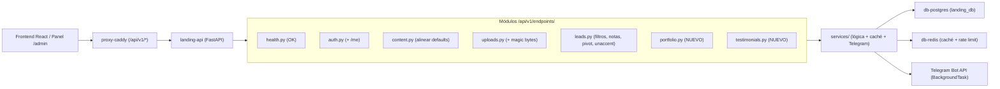

# Guía y Especificación de la API Backend (Parte 2) — `tuxserver`

Guía técnica y paso a paso para evolucionar el backend **FastAPI** de `/mnt/raid/docker/landing/backend/` sobre el esquema completo de `landing_db` (6 tablas, 2 vistas, 2 triggers y búsqueda `public.spanish_unaccent` ya implementados en la Parte 1).

> **Stack:** Python 3.12 · FastAPI · Pydantic v2 · SQLAlchemy 2.0 · PostgreSQL 16 · Redis 7 · `slowapi` · PyJWT + Argon2.  
> **Ruta del código:** `/mnt/raid/docker/landing/backend/`  
> **Referencia de BD:** [db-landing.md](./db-landing.md) · **Plan general:** [plan-de-trabajo-landing.md](./plan-de-trabajo-landing.md)

---

## 1. Estado Actual vs. Alcance de la Parte 2

El backend ya cuenta con una base operativa (`health`, `auth`, `content`, `leads` básico, `uploads`). La Parte 2 extiende los módulos existentes y agrega **2 dominios nuevos** (`portfolio` y `testimonials`) más el seguimiento CRM (`lead_notes`, resúmenes y búsqueda full-text):



### Arquitectura por capas (regla de diseño)
- **`app/schemas/`:** contratos de entrada (`Create`, `Update`) y salida (`Out`, `Summary`) con Pydantic v2. Nunca devolver modelos SQLAlchemy crudos ni campos internos como `password_hash` o `ip_hash`.
- **`app/api/v1/endpoints/`:** controladores delgados; solo validan parámetros HTTP, aplican `Depends(get_current_admin)` o `@limiter.limit(...)` y delegan a `services/`.
- **`app/services/`:** consultas SQLAlchemy/SQL, manejo de caché en Redis y notificaciones en segundo plano.

---

## 2. Mapa Oficial de Endpoints (`/api/v1`)

| Dominio | Método y Ruta | Acceso | Estado | Propósito |
| :--- | :--- | :---: | :---: | :--- |
| **Health** | `GET /api/v1/health` | Público | Listo | Verifica `SELECT 1` en Postgres y `PING` en Redis. |
| **Auth** | `POST /api/v1/auth/login` | Público (`10/min`) | Pulir | Emite JWT tras validar Argon2 (búsqueda `LOWER(email)`). |
| **Auth** | `GET /api/v1/auth/me` | Admin JWT | **Nuevo** | Devuelve correo/estado del admin actual (valida sesión en `/admin`). |
| **Content** | `GET /api/v1/content` | Público | Pulir | Devuelve las 6 secciones con caché Redis (TTL 10 min). |
| **Content** | `PUT /api/v1/content/{slug}` | Admin JWT | Listo | Crea o actualiza una sección e invalida caché Redis. |
| **Uploads** | `POST /api/v1/uploads` | Admin JWT | Pulir | Sube imagen WebP/PNG/JPEG (`<= 5 MB`) validando *magic bytes* + UUID. |
| **Leads** | `POST /api/v1/leads` | Público (`5/min`) | **Ampliar** | Recibe formulario adaptativo (honeypot + categoría/subcategoría/modalidad + Telegram). |
| **Leads** | `GET /api/v1/leads` | Admin JWT | **Ampliar** | Bandeja CRM con filtros `?category=&status=&q=&limit=&offset=` usando `v_leads_overview` y `spanish_unaccent`. |
| **Leads** | `GET /api/v1/leads/summary` | Admin JWT | **Nuevo** | Matriz cruzada Categoría × Estado desde `v_leads_summary_pivot`. |
| **Leads** | `GET /api/v1/leads/{id}` | Admin JWT | **Nuevo** | Detalle completo de un lead con su historial de notas. |
| **Leads** | `PATCH /api/v1/leads/{id}` | Admin JWT | **Nuevo** | Actualiza estado (`nuevo` → `contactado` → `en_proceso` → `cerrado` → `archivado`) u otros campos CRM. |
| **Notes** | `GET /api/v1/leads/{id}/notes` | Admin JWT | **Nuevo** | Lista notas del lead ordenadas por `created_at DESC`. |
| **Notes** | `POST /api/v1/leads/{id}/notes` | Admin JWT | **Nuevo** | Agrega nota interna (asigna `author_id` y dispara `trg_lead_notes_touch_lead`). |
| **Notes** | `DELETE /api/v1/leads/{id}/notes/{note_id}` | Admin JWT | **Nuevo** | Elimina una nota específica del lead. |
| **Portfolio** | `GET /api/v1/portfolio` | Público | **Nuevo** | Lista evidencias publicadas (`?category=&featured=&tag=`). |
| **Portfolio** | `GET /api/v1/portfolio/admin` | Admin JWT | **Nuevo** | Lista todas las evidencias (incluidos borradores `is_published=false`). |
| **Portfolio** | `POST /api/v1/portfolio` | Admin JWT | **Nuevo** | Crea evidencia/proyecto (`201 Created`). |
| **Portfolio** | `PATCH /api/v1/portfolio/{id}` | Admin JWT | **Nuevo** | Actualización parcial (orden, destacado, publicado, tags, URLs). |
| **Portfolio** | `DELETE /api/v1/portfolio/{id}` | Admin JWT | **Nuevo** | Elimina una evidencia (`204 No Content`). |
| **Testimonials** | `GET /api/v1/testimonials` | Público | **Nuevo** | Lista reseñas publicadas (`?category=`) ordenadas por `sort_order ASC`. |
| **Testimonials** | `GET /api/v1/testimonials/admin` | Admin JWT | **Nuevo** | Lista todas las reseñas (incluidos borradores). |
| **Testimonials** | `POST /api/v1/testimonials` | Admin JWT | **Nuevo** | Crea reseña (`rating` 1..5, `201 Created`). |
| **Testimonials** | `PATCH /api/v1/testimonials/{id}` | Admin JWT | **Nuevo** | Edita reseña o visibilidad (`is_published`). |
| **Testimonials** | `DELETE /api/v1/testimonials/{id}` | Admin JWT | **Nuevo** | Elimina reseña (`204 No Content`). |

---

## 3. Contratos Pydantic (`app/schemas/schemas.py`)

Para evitar duplicaciones y asegurar validación estricta en FastAPI, define tipos literales reutilizables alineados con los `CHECK` constraints de PostgreSQL:

```python
from typing import Literal

LeadCategory = Literal["desarrollo", "soporte", "academia", "general"]
PortfolioCategory = Literal["desarrollo", "soporte", "academia"]
LeadModality = Literal["presencial", "remoto", "hibrido"]
LeadStatus = Literal["nuevo", "contactado", "en_proceso", "cerrado", "archivado"]
```

### 3.1 Leads y Notas
- **`LeadCreate` (entrada pública):**
  - Obligatorios: `name` (`2..120`), `email` (`EmailStr`), `message` (`5..2000`).
  - Opcionales / con defecto:
    - `phone: str | None = Field(default=None, max_length=40)`
    - `service_category: LeadCategory = "general"`
    - `subcategory: str | None = Field(default=None, max_length=64)`
    - `modality: LeadModality | None = None`
    - `estimated_budget: str | None = Field(default=None, max_length=64)`
    - `source: str = Field(default="landing", max_length=64)`
    - `website: str = Field(default="", max_length=120)` *(honeypot invisible)*.
- **`LeadUpdate` (entrada admin `PATCH`):** todos los campos opcionales (`status`, `service_category`, `subcategory`, `modality`, `estimated_budget`, `phone`).
- **`LeadAdminOut` (bandeja CRM):** `id`, `name`, `email`, `phone`, `service_category`, `subcategory`, `modality`, `estimated_budget`, `message`, `source`, `status`, `created_at`, `updated_at`, `notes_count: int = 0`, `last_note: str | None = None`, `last_note_at: dt.datetime | None = None`.
- **`LeadDetailOut`:** hereda de `LeadAdminOut` y añade `notes: list[LeadNoteOut]`.
- **`LeadNoteCreate`:** `note: str = Field(min_length=2, max_length=2000)`.
- **`LeadNoteOut`:** `id`, `lead_id`, `author_id`, `note`, `created_at`.
- **`LeadSummaryRow`:** `service_category`, `nuevos`, `contactados`, `en_proceso`, `cerrados`, `archivados`, `total`.

### 3.2 Portfolio (`PortfolioItem`)
- **`PortfolioItemCreate`:** `category: PortfolioCategory`, `title` (`3..160`), `slug: str | None` (patrón `^[a-z0-9-]+$`), `client_label`, `description` (`10..4000`), `tech_tags: list[str] = Field(default_factory=list, max_length=15)`, `image_url`, `before_image_url`, `demo_url`, `video_url`, `is_featured: bool = False`, `sort_order: int = 0`, `is_published: bool = True`.
- **`PortfolioItemUpdate`:** mismos campos, todos opcionales (`None` por defecto) para aplicar solo `model_dump(exclude_unset=True)`.
- **`PortfolioItemOut`:** incluye `id`, `created_at`, `updated_at`.

### 3.3 Testimonials (`Testimonial`)
- **`TestimonialCreate`:** `category: LeadCategory`, `client_name` (`2..120`), `client_role`, `company_or_institution`, `comment` (`10..2000`), `rating: int = Field(default=5, ge=1, le=5)`, `avatar_url`, `sort_order: int = 0`, `is_published: bool = True`.
- **`TestimonialUpdate`:** todos opcionales (`exclude_unset=True`).
- **`TestimonialOut`:** incluye `id`, `created_at`, `updated_at`.

### 3.4 Auth
- **`AdminMeOut`:** `id: int`, `email: str`, `is_active: bool`.

---

## 4. Detalles Técnicos Clave y Compatibilidad SQLite (`pytest`)

Como [test_api.py](/mnt/raid/docker/landing/backend/tests/test_api.py) corre en **SQLite en memoria** para pruebas ultrarrápidas, los servicios deben detectar el dialecto cuando usen características exclusivas de PostgreSQL:

```python
is_postgres = db.bind is not None and db.bind.dialect.name == "postgresql"
```

| Funcionalidad | En PostgreSQL (`tuxserver`) | Fallback en SQLite (`pytest`) |
| :--- | :--- | :--- |
| **Búsqueda `?q=` en `leads`** | `search_vector @@ plainto_tsquery('public.spanish_unaccent', :q)` (usa índice `GIN` sin tildes). | `ILIKE` sobre `name`, `email`, `subcategory`, `message`. |
| **Bandeja CRM (`GET /leads`)** | Consulta `v_leads_overview` (o `LEFT JOIN LATERAL`) para traer `notes_count`, `last_note`, `last_note_at`. | Consulta ORM con conteo y última nota en Python/SQL estándar. |
| **Resumen (`GET /leads/summary`)** | `SELECT * FROM v_leads_summary_pivot ORDER BY service_category`. | Agregación equivalente con `GROUP BY service_category` y `CASE WHEN`. |
| **Filtro `?tag=` en `portfolio`** | `PortfolioItem.tech_tags.contains([tag])` (`@>` sobre `JSONB` con índice `GIN`). | Filtrado sobre la lista JSON deserializada en Python. |

### Ajustes de seguridad obligatorios en la Parte 2
1. **CORS en [main.py](/mnt/raid/docker/landing/backend/app/main.py):** añadir `"PATCH"` a `allow_methods` (`["GET", "POST", "PUT", "PATCH", "DELETE"]`), si no el navegador bloqueará los `PATCH` del panel `/admin`.
2. **Validación real de archivos en [uploads.py](/mnt/raid/docker/landing/backend/app/api/v1/endpoints/uploads.py):** además de `file.content_type`, validar los **magic bytes** del binario leído:
   - PNG: empieza por `b"\x89PNG\r\n\x1a\n"`
   - JPEG: empieza por `b"\xff\xd8\xff"`
   - WebP: empieza por `b"RIFF"` y bytes `8:12 == b"WEBP"`
3. **Autenticación case-insensitive en [auth.py](/mnt/raid/docker/landing/backend/app/api/v1/endpoints/auth.py) y [security.py](/mnt/raid/docker/landing/backend/app/core/security.py):** consultar `func.lower(AdminUser.email) == email.lower()` para aprovechar `idx_admin_users_email_lower`.
4. **Caché Redis:**
   - `GET /api/v1/content` ya cachea `landing:content:v1` (TTL 10 min) y lo invalida en `PUT`. Alinear `DEFAULT_SECTIONS` con las 6 claves de [seed.py](/mnt/raid/docker/landing/backend/app/db/seed.py).
   - Opcionalmente cachear `GET /api/v1/portfolio` y `GET /api/v1/testimonials` públicos (invalidando en `POST`/`PATCH`/`DELETE`), o consultar directo a los índices parciales (que responden en `< 2 ms`).
5. **Notificación Telegram enriquecida en [lead_service.py](/mnt/raid/docker/landing/backend/app/services/lead_service.py):** incluir `service_category`, `subcategory`, `modality`, `estimated_budget` y escapar siempre con `html.escape(...)` para evitar inyección de etiquetas HTML.

---

## 5. Orden Recomendado de Implementación (Paso a Paso en VS Code)

Implementa en **5 bloques pequeños**, probando cada bloque antes de pasar al siguiente:

### Bloque 1 — Esquemas y ajustes base
1. Actualizar `backend/app/schemas/schemas.py` con los tipos literales y los esquemas de `Lead`, `LeadNote`, `PortfolioItem`, `Testimonial` y `AdminMeOut`.
2. Añadir `"PATCH"` a `allow_methods` en `backend/app/main.py`.
3. Usar `func.lower(AdminUser.email)` en `auth.py` y `security.py`, y añadir `GET /api/v1/auth/me`.
4. Alinear `DEFAULT_SECTIONS` de `content_service.py` con `INITIAL_CONTENT_SECTIONS` de `seed.py` (evitando duplicar los textos).
5. Añadir validación de *magic bytes* en `uploads.py`.

### Bloque 2 — Leads avanzados + Notas + Resumen CRM
1. Ampliar `backend/app/services/lead_service.py`:
   - `create_lead(...)` guardando `service_category`, `subcategory`, `modality`, `estimated_budget`.
   - `notify_lead_telegram(...)` con los campos nuevos y formato claro.
   - `list_leads(...)` (filtros `category`, `status`, `q`, `limit`, `offset`), `get_leads_summary(...)`, `get_lead_detail(...)`, `update_lead(...)`, `add_lead_note(...)`, `delete_lead_note(...)`.
2. Ampliar `backend/app/api/v1/endpoints/leads.py` exponiendo las rutas del mapa.
   - **Ojo en FastAPI con el orden de rutas:** registra `GET /summary` **antes** de `GET /{lead_id}`, para que FastAPI no intente parsear `"summary"` como entero `lead_id`.

### Bloque 3 — Portafolio (`/api/v1/portfolio`)
1. Crear `backend/app/services/portfolio_service.py` (CRUD + filtro `category`, `featured`, `tag` y manejo limpio de `IntegrityError` -> `409 Conflict` si el `slug` ya existe).
2. Crear `backend/app/api/v1/endpoints/portfolio.py` (registrando `GET /admin` antes de rutas con `{item_id}`).
3. Registrar `portfolio.router` en `backend/app/api/v1/router.py`.

### Bloque 4 — Testimonios (`/api/v1/testimonials`)
1. Crear `backend/app/services/testimonial_service.py` (CRUD + filtro `category`).
2. Crear `backend/app/api/v1/endpoints/testimonials.py` (registrando `GET /admin` antes de `{testimonial_id}`).
3. Registrar `testimonials.router` en `backend/app/api/v1/router.py`.

### Bloque 5 — Pruebas automatizadas y verificación real en `tuxserver`
1. Ampliar `backend/tests/test_api.py` cubriendo:
   - `POST /api/v1/leads` con categoría/subcategoría/modalidad + bloqueo honeypot + rechazo `422` ante categoría inválida.
   - `GET /api/v1/leads` con filtros `?category=&status=&q=`, `GET /api/v1/leads/summary`, `PATCH /api/v1/leads/{id}` y CRUD de `lead_notes`.
   - CRUD completo de `/api/v1/portfolio` (público solo ve `is_published=true`, filtro `?tag=`, rechazo `401` sin JWT y `409` en `slug` duplicado).
   - CRUD completo de `/api/v1/testimonials` (rechazo `422` si `rating=6`, público solo ve publicados).
   - `POST /api/v1/uploads` (acepta PNG/WebP válidos y rechaza archivo falso con header `image/png` pero contenido texto).
   - `GET /api/v1/auth/me` con token válido (`200`) y sin token (`401`).
2. Correr `pytest` y validar en vivo contra el `db-postgres` real dentro de `landing-api` (`docker compose up -d --build --wait landing-api`).

---

## 6. Checklist de Cierre de la Parte 2

- [x] **Bloque 1:** `schemas.py`, CORS con `PATCH`, `auth/me`, `content_service.py` alineado con `seed.py` y *magic bytes* en `uploads.py`.
- [x] **Bloque 2:** `leads.py` + `lead_service.py` (categorías, búsqueda `spanish_unaccent`, `v_leads_overview`, `v_leads_summary_pivot`, `PATCH` y `lead_notes` + Telegram enriquecido).
- [x] **Bloque 3:** `portfolio.py` + `portfolio_service.py` registrados en `router.py`.
- [x] **Bloque 4:** `testimonials.py` + `testimonial_service.py` registrados en `router.py`.
- [ ] **Bloque 5:** `pytest` 100% en verde, `landing-api` reconstruido y `(healthy)`, prueba real contra `db-postgres` (pendiente solo commit en Git).
