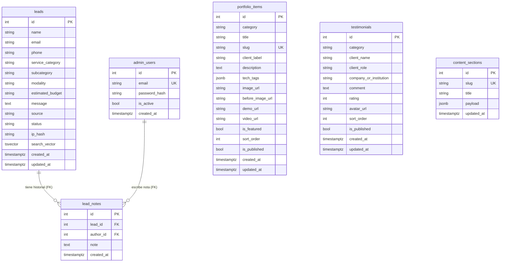

# Especificación y Discusión de Base de Datos: `landing_db` — `tuxserver`

Documento técnico de referencia para definir las tablas, columnas, tipos de datos, restricciones, índices, vistas y triggers de la base de datos de la landing page antes de aplicar la migración con Alembic.

> **Motor:** PostgreSQL 16 (contenedor `db-postgres` en red aislada `internal_net`).  
> **ORM / Migraciones:** SQLAlchemy 2.0 + Alembic.  
> **Respaldos:** Dumps lógicos diarios automáticos vía `/mnt/raid/docker/databases/dump_databases.sh` hacia `BACKUP-USB`.

---

## 1. Resumen Oficial de Tablas

| Tabla | Propósito | Rol en el sistema |
| :--- | :--- | :--- |
| **`leads`** | Solicitudes y formularios de prospectos | Categoriza por pestañas (`desarrollo`, `soporte`, `academia`), subcategoría, modalidad, presupuesto y estado del lead. |
| **`lead_notes`** | Historial de seguimiento interno a prospectos | Registra notas de llamadas, acuerdos o cotizaciones enviadas a cada cliente. Relación 1:N con `leads`. |
| **`portfolio_items`** | Evidencias visuales de proyectos y trabajos | Muestra capturas de Web Apps, apps Kotlin, maquetas de hardware y comparativa "Antes / Después" en soporte. |
| **`testimonials`** | Reseñas y recomendaciones de clientes/estudiantes | Calificaciones de 1 a 5 estrellas, rol/empresa y comentarios para generar prueba social por categoría. |
| **`content_sections`** | Textos y configuraciones editables del sitio | Bloques JSON flexibles (`hero`, `tab_desarrollo`, `tab_soporte`, `tab_academia`, `faq`, `contact_channels`). *(Ya implementada)* |
| **`admin_users`** | Credenciales de acceso al panel privado | Autenticación administrativa con contraseñas Argon2 y tokens de sesión JWT. *(Ya implementada)* |

---

## 2. Detalle de Tablas

### 2.1 Tabla `leads` (Prospectos y Formularios)
Almacena los mensajes enviados desde el formulario web de cualquiera de las 3 pestañas, con soporte para búsqueda en español y clasificación rápida.

```sql
CREATE TABLE leads (
    id INT GENERATED BY DEFAULT AS IDENTITY PRIMARY KEY,
    name VARCHAR(120) NOT NULL,
    email VARCHAR(180) NOT NULL,
    phone VARCHAR(40),                          -- Opcional en BD; recomendado en UI para WhatsApp (Colombia/LATAM)
    service_category VARCHAR(32) NOT NULL
        CHECK (service_category IN ('desarrollo', 'soporte', 'academia', 'general')),
    subcategory VARCHAR(64),                    -- 'Web App', 'App Android Kotlin', 'Laptop', 'Clase Lógica'
    modality VARCHAR(20)
        CHECK (modality IN ('presencial', 'remoto', 'hibrido')),
    estimated_budget VARCHAR(64),               -- Opcional: rango o texto breve de presupuesto
    message TEXT NOT NULL,
    source VARCHAR(64) NOT NULL DEFAULT 'landing', -- 'landing', 'whatsapp_referral', etc.
    status VARCHAR(24) NOT NULL DEFAULT 'nuevo'
        CHECK (status IN ('nuevo', 'contactado', 'en_proceso', 'cerrado', 'archivado')),
    ip_hash VARCHAR(64),                        -- Hash SHA-256 de la IP para rate limiting y auditoría sin guardar IP en texto plano
    search_vector TSVECTOR GENERATED ALWAYS AS (
        to_tsvector(
            'spanish',
            coalesce(name, '') || ' ' ||
            coalesce(email, '') || ' ' ||
            coalesce(subcategory, '') || ' ' ||
            coalesce(message, '')
        )
    ) STORED,
    created_at TIMESTAMPTZ NOT NULL DEFAULT NOW(),
    updated_at TIMESTAMPTZ NOT NULL DEFAULT NOW()
);

-- Índices optimizados para consultas del panel /admin
CREATE INDEX idx_leads_active
    ON leads (created_at DESC)
    WHERE status IN ('nuevo', 'contactado', 'en_proceso');
CREATE INDEX idx_leads_category_status ON leads (service_category, status);
CREATE INDEX idx_leads_search ON leads USING GIN (search_vector);
```

---

### 2.2 Tabla `portfolio_items` (Evidencias y Trabajos Realizados)
Permite mostrar pruebas tangibles en cada una de las 3 pestañas (alimentada desde `/mnt/raid/docker/landing/uploads/` y organizada desde el NAS de trabajos en `/mnt/raid/trabajos/`).

```sql
CREATE TABLE portfolio_items (
    id INT GENERATED BY DEFAULT AS IDENTITY PRIMARY KEY,
    category VARCHAR(32) NOT NULL
        CHECK (category IN ('desarrollo', 'soporte', 'academia')),
    title VARCHAR(160) NOT NULL,                -- ej: 'Sistema de Gestión de Facturación Web'
    slug VARCHAR(180) UNIQUE,                   -- URL amigable opcional (UNIQUE ya crea índice único)
    client_label VARCHAR(120),                  -- Opcional: nombre genérico ('Pyme sector salud') o real si autoriza
    description TEXT NOT NULL,                  -- Resumen del problema resuelto y tecnologías
    tech_tags JSONB NOT NULL DEFAULT '[]'::jsonb, -- ["React", "FastAPI", "Kotlin", "ESP32", "Electrónica"]

    -- Imágenes / Evidencias multimedia
    image_url VARCHAR(255) NOT NULL,            -- URL relativa hacia /uploads/xxx.webp
    before_image_url VARCHAR(255),              -- Solo para 'soporte': foto del "Antes" en reparaciones
    demo_url VARCHAR(255),                      -- Enlace a demo funcional o repositorio público (GitHub)
    video_url VARCHAR(255),                     -- Enlace a video corto explicativo (YouTube/Vimeo o MP4 local)

    -- Control de publicación
    is_featured BOOLEAN NOT NULL DEFAULT FALSE, -- Para destacar en la portada principal (Home)
    sort_order INT NOT NULL DEFAULT 0,          -- Orden personalizado de visualización
    is_published BOOLEAN NOT NULL DEFAULT TRUE,

    created_at TIMESTAMPTZ NOT NULL DEFAULT NOW(),
    updated_at TIMESTAMPTZ NOT NULL DEFAULT NOW()
);

-- Índice parcial: solo indexa lo que la landing pública consulta
CREATE INDEX idx_portfolio_public
    ON portfolio_items (category, is_featured DESC, sort_order ASC)
    WHERE is_published = TRUE;
-- Índice GIN para filtrar por tecnología dentro del arreglo JSONB
CREATE INDEX idx_portfolio_tech_tags ON portfolio_items USING GIN (tech_tags);
```

---

### 2.3 Tabla `content_sections` (Textos y Configuración Dinámica)
Ya implementada. Permite modificar textos del Hero, enlaces de contacto y preguntas frecuentes sin reescribir código React ni hacer nuevos despliegues.

```sql
CREATE TABLE content_sections (
    id INT GENERATED BY DEFAULT AS IDENTITY PRIMARY KEY,
    slug VARCHAR(64) UNIQUE NOT NULL,           -- 'hero', 'tab_desarrollo', 'tab_soporte', 'tab_academia', 'faq', 'contact_channels'
    title VARCHAR(160) NOT NULL,
    payload JSONB NOT NULL,                     -- Estructura libre para cada bloque
    updated_at TIMESTAMPTZ NOT NULL DEFAULT NOW()
);
-- Nota: UNIQUE en slug ya crea el índice único automáticamente; no se duplica.
```

#### Secciones previstas en el `payload`:
- `hero`: `{"title": "...", "subtitle": "...", "cta_primary_text": "...", "cta_whatsapp_text": "..."}`
- `tab_desarrollo`: `{"value_proposition": "...", "services": [{"title": "...", "description": "...", "icon": "..."}]}`
- `tab_soporte`: `{"value_proposition": "...", "diagnostico_info": "...", "services": [...]}`
- `tab_academia`: `{"value_proposition": "...", "courses": [...], "advisory_options": [...]}`
- `faq`: `{"items": [{"question": "...", "answer": "...", "category": "desarrollo"}]}`
- `contact_channels`: `{"whatsapp": "57300...", "github": "...", "linkedin": "...", "email": "..."}`

---

### 2.4 Tabla `admin_users` (Autenticación del Panel)
Ya implementada con soporte para contraseñas seguras bajo Argon2 y tokens de sesión JWT.

```sql
CREATE TABLE admin_users (
    id INT GENERATED BY DEFAULT AS IDENTITY PRIMARY KEY,
    email VARCHAR(180) NOT NULL,
    password_hash VARCHAR(255) NOT NULL,
    is_active BOOLEAN NOT NULL DEFAULT TRUE,
    created_at TIMESTAMPTZ NOT NULL DEFAULT NOW()
);

-- Índice único funcional: impide duplicados por mayúsculas/minúsculas (Admin@... vs admin@...)
CREATE UNIQUE INDEX idx_admin_users_email_lower ON admin_users (LOWER(email));
```

---

### 2.5 Tabla `testimonials` (Reseñas y Recomendaciones Aprobadas)
Almacena testimonios de clientes y estudiantes para mostrar prueba social en cada pestaña o en el Home.

```sql
CREATE TABLE testimonials (
    id INT GENERATED BY DEFAULT AS IDENTITY PRIMARY KEY,
    category VARCHAR(32) NOT NULL
        CHECK (category IN ('desarrollo', 'soporte', 'academia', 'general')),
    client_name VARCHAR(120) NOT NULL,
    client_role VARCHAR(120),                   -- ej: 'Gerente en Pyme X' o 'Estudiante Ing. Electrónica'
    company_or_institution VARCHAR(120),        -- ej: 'TechSolutions S.A.S.' o 'Universidad Nacional'
    comment TEXT NOT NULL,
    rating INT NOT NULL DEFAULT 5 CHECK (rating >= 1 AND rating <= 5),
    avatar_url VARCHAR(255),                    -- Foto del cliente o avatar representativo
    sort_order INT NOT NULL DEFAULT 0,
    is_published BOOLEAN NOT NULL DEFAULT TRUE,
    created_at TIMESTAMPTZ NOT NULL DEFAULT NOW(),
    updated_at TIMESTAMPTZ NOT NULL DEFAULT NOW()
);

CREATE INDEX idx_testimonials_public
    ON testimonials (category, sort_order ASC)
    WHERE is_published = TRUE;
```

---

### 2.6 Tabla `lead_notes` (Historial de Seguimiento Interno a Prospectos)
Permite que desde el panel `/admin` registres notas cada vez que llames o hables con un cliente por WhatsApp.

```sql
CREATE TABLE lead_notes (
    id INT GENERATED BY DEFAULT AS IDENTITY PRIMARY KEY,
    lead_id INT NOT NULL REFERENCES leads(id) ON DELETE CASCADE,
    author_id INT REFERENCES admin_users(id) ON DELETE SET NULL,
    note TEXT NOT NULL,                         -- ej: 'Llamado el 22-nov: acordamos enviar cotización de App Android'
    created_at TIMESTAMPTZ NOT NULL DEFAULT NOW()
);

-- Índice compuesto óptimo para traer las últimas notas de un lead específico
CREATE INDEX idx_lead_notes_lead_created ON lead_notes (lead_id, created_at DESC);
```

---

## 3. Estrategia de Optimización PostgreSQL 16 (Qué aplicamos y por qué)

Esta sección define las técnicas de base de datos que **sí aportan valor real** para el tamaño y patrón de tráfico de `landing_db` (muchas lecturas públicas rápidas + gestión CRM ligera en `/admin`), evitando sobreingeniería innecesaria.

### 3.1 Triggers de Integridad (Automatización sin lógica de negocio)

**Por qué se aplican:**
- En PostgreSQL, `DEFAULT NOW()` solo se ejecuta al insertar una fila (`INSERT`), **nunca** al modificarla (`UPDATE`). Si solo dependes del ORM, cualquier ajuste manual por `psql` o script de mantenimiento dejaría `updated_at` desactualizado. Un trigger garantiza consistencia a nivel de motor.
- Cuando registras una nota en `lead_notes`, actualizar automáticamente `leads.updated_at` permite ordenar el panel `/admin` por *"leads con actividad más reciente"* sin hacer cálculos costosos en cada consulta.

**Qué NO meter en triggers:** envío de correos, webhooks de WhatsApp o reglas comerciales cambiantes; eso debe vivir en FastAPI para poder probarlo, registrar logs y manejar reintentos.

```sql
-- 1. Función genérica reutilizable para updated_at
CREATE OR REPLACE FUNCTION set_updated_at()
RETURNS TRIGGER AS $$
BEGIN
    NEW.updated_at = NOW();
    RETURN NEW;
END;
$$ LANGUAGE plpgsql;

CREATE TRIGGER trg_leads_updated_at
    BEFORE UPDATE ON leads
    FOR EACH ROW EXECUTE FUNCTION set_updated_at();

CREATE TRIGGER trg_portfolio_items_updated_at
    BEFORE UPDATE ON portfolio_items
    FOR EACH ROW EXECUTE FUNCTION set_updated_at();

CREATE TRIGGER trg_testimonials_updated_at
    BEFORE UPDATE ON testimonials
    FOR EACH ROW EXECUTE FUNCTION set_updated_at();

CREATE TRIGGER trg_content_sections_updated_at
    BEFORE UPDATE ON content_sections
    FOR EACH ROW EXECUTE FUNCTION set_updated_at();

-- 2. Función para reflejar actividad en el lead al agregar una nota
CREATE OR REPLACE FUNCTION touch_lead_on_note()
RETURNS TRIGGER AS $$
BEGIN
    UPDATE leads SET updated_at = NOW() WHERE id = NEW.lead_id;
    RETURN NEW;
END;
$$ LANGUAGE plpgsql;

CREATE TRIGGER trg_lead_notes_touch_lead
    AFTER INSERT ON lead_notes
    FOR EACH ROW EXECUTE FUNCTION touch_lead_on_note();
```

---

### 3.2 Vistas Operacionales y Matriz Cruzada (Pivot)

**Por qué vistas normales (`VIEW`) y NO vistas materializadas (`MATERIALIZED VIEW`) por ahora:**
- Una landing page maneja cientos o pocos miles de registros. Con los índices definidos abajo, las vistas normales responden en **< 2 ms** y siempre muestran datos en tiempo real.
- Una `MATERIALIZED VIEW` exige gestionar refrescos (`REFRESH MATERIALIZED VIEW CONCURRENTLY`) mediante cron o eventos, añadiendo complejidad operativa sin beneficio medible a este volumen. Solo tendría sentido si superas decenas de miles de leads o reportes históricos pesados.

#### A. Vista de bandeja CRM (`v_leads_overview`)
Combina cada lead con su cantidad total de notas y el texto/fecha de su último seguimiento usando `LEFT JOIN LATERAL`, que aprovecha directamente el índice `idx_lead_notes_lead_created (lead_id, created_at DESC)` para leer solo la nota más reciente de cada lead.

```sql
CREATE OR REPLACE VIEW v_leads_overview AS
SELECT
    l.id,
    l.name,
    l.email,
    l.phone,
    l.service_category,
    l.subcategory,
    l.modality,
    l.estimated_budget,
    l.source,
    l.status,
    l.created_at,
    l.updated_at,
    COALESCE(n.notes_count, 0) AS notes_count,
    n.last_note,
    n.last_note_at
FROM leads l
LEFT JOIN LATERAL (
    SELECT
        COUNT(*)::INT AS notes_count,
        (ARRAY_AGG(note ORDER BY created_at DESC))[1] AS last_note,
        MAX(created_at) AS last_note_at
    FROM lead_notes
    WHERE lead_id = l.id
) n ON TRUE;
```

#### B. Vista cruzada / Pivot para el Dashboard (`v_leads_summary_pivot`)
Genera una tabla cruzada **Categoría (filas) × Estado (columnas)** en una sola pasada sobre `leads`. En PostgreSQL 16 usar `COUNT(*) FILTER (WHERE ...)` es más rápido, legible y estándar que instalar la extensión `tablefunc` (`crosstab`).

```sql
CREATE OR REPLACE VIEW v_leads_summary_pivot AS
SELECT
    service_category,
    COUNT(*) FILTER (WHERE status = 'nuevo')      AS nuevos,
    COUNT(*) FILTER (WHERE status = 'contactado') AS contactados,
    COUNT(*) FILTER (WHERE status = 'en_proceso') AS en_proceso,
    COUNT(*) FILTER (WHERE status = 'cerrado')    AS cerrados,
    COUNT(*) FILTER (WHERE status = 'archivado')  AS archivados,
    COUNT(*)                                      AS total
FROM leads
GROUP BY service_category;
```

---

### 3.3 Índices Especializados (Mayor impacto real en rendimiento)

| Técnica | Dónde se aplica | Por qué optimiza este caso |
| :--- | :--- | :--- |
| **Índices parciales (`WHERE`)** | `idx_leads_active`, `idx_portfolio_public`, `idx_testimonials_public` | La landing pública **nunca** consulta borradores (`is_published = FALSE`) y el panel diario trabaja sobre leads activos. Al excluir filas inactivas/archivadas, el índice ocupa menos RAM y disco y acelera tanto lecturas como escrituras. |
| **Índice `GIN` sobre `JSONB`** | `idx_portfolio_tech_tags` | Permite filtrar proyectos por tecnología (`WHERE tech_tags @> '["Kotlin"]'`) sin escanear toda la tabla. |
| **Índice `GIN` + `tsvector` generado** | `leads.search_vector` + `idx_leads_search` | Reemplaza búsquedas lentas tipo `ILIKE '%facturacion%'` por búsqueda lingüística en español (ignora tildes, plurales y tiempos verbales) mantenida automáticamente por PostgreSQL en cada `INSERT`/`UPDATE`. |
| **Índice único funcional (`LOWER`)** | `idx_admin_users_email_lower` | Garantiza unicidad real de correos sin importar mayúsculas/minúsculas sin necesitar extensiones extra como `citext`. |
| **Eliminación de índices duplicados** | `content_sections.slug`, `portfolio_items.slug` | En PostgreSQL toda restricción `UNIQUE` crea implícitamente su índice B-Tree; crear otro `UNIQUE INDEX` encima duplica el costo de escritura sin ganancia. |

---

### 3.4 Decisión sobre Tablas Cruzadas (N:M) vs `JSONB`

- **Decisión actual:** mantener `portfolio_items.tech_tags` como `JSONB` + índice `GIN`.
- **Por qué es la mejor opción hoy:** evita 2 tablas adicionales (`tags` y `portfolio_item_tags`) y `JOIN`s en cada carga del portafolio público, manteniendo el CRUD de `/admin` simple y rápido.
- **Cuándo migrar a tabla cruzada N:M:** únicamente si a futuro necesitas metadatos propios por etiqueta (ícono SVG, color, descripción SEO, página dedicada `/tecnologia/kotlin`) o etiquetas compartidas entre múltiples entidades (por ejemplo, etiquetar tanto proyectos como leads).

---

### 3.5 Nota clave para Alembic (`0002_add_full_schema.py`)

`alembic revision --autogenerate` detecta tablas, columnas, `CHECK` constraints e índices estándar, **pero NO detecta funciones PL/pgSQL, triggers ni vistas**.  
Por ello, en la migración `0002_add_full_schema.py` se deben añadir explícitamente bloques `op.execute(...)`:
- En `upgrade()`: crear funciones, triggers y vistas **después** de crear las tablas.
- En `downgrade()`: ejecutar `DROP VIEW IF EXISTS ...`, `DROP TRIGGER IF EXISTS ...` y `DROP FUNCTION IF EXISTS ...` **antes** de eliminar las tablas.

---

## 4. Diagrama de Relaciones de `landing_db`



> **Nota de modelado:** `portfolio_items` y `testimonials` se agrupan con `content_sections` de forma **lógica** por `category` (`desarrollo`, `soporte`, `academia`), sin llave foránea rígida, para permitir agregar o reorganizar secciones del sitio sin romper integridad referencial.

---

## 5. Próximo Paso Técnico

Con este esquema optimizado de **6 tablas, 2 vistas y 2 funciones trigger** aprobado, procedemos a:
1. Actualizar las entidades SQLAlchemy en `backend/app/models/entities.py`.
2. Generar y revisar la migración Alembic `0002_add_full_schema.py` (incluyendo los bloques `op.execute(...)` para triggers y vistas).
3. Crear la base de datos `landing_db` y el usuario `landing_user` en el PostgreSQL real (`db-postgres`).
4. Aplicar la migración (`alembic upgrade head`) y validar consultas, triggers y vistas.
