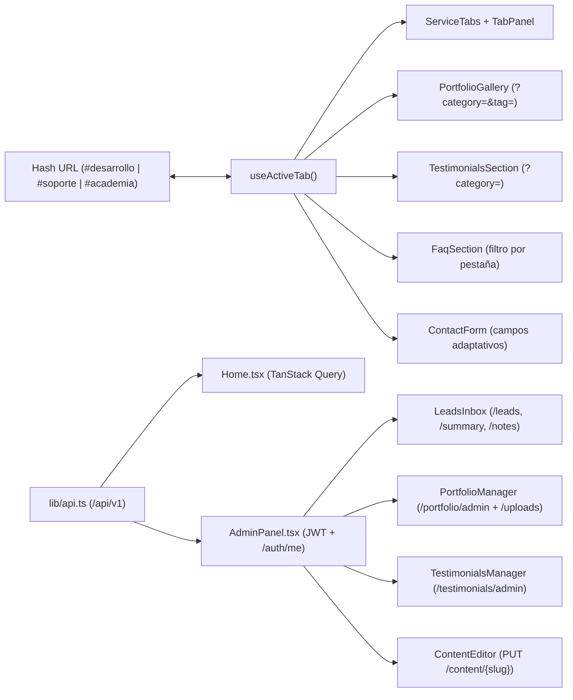

# Guía y Especificación del Frontend (Parte 3) — `tuxserver`

Guía técnica y plan paso a paso para evolucionar el frontend **React + Vite + TypeScript + Tailwind CSS v4** de `/mnt/raid/docker/landing/frontend/` sobre la API v1 completada en la Parte 2, con estética oscura de alto impacto inspirada en **Magnific.com** y acentos de identidad **Tux (Linux)**.

> **Stack:** React 19 · TypeScript 5.7 · Vite 6 · Tailwind CSS v4 (`@tailwindcss/vite`) · TanStack Query v5 · React Hook Form v7 + Zod v3 · React Router v7 · Lucide Icons.  
> **Ruta del código:** `/mnt/raid/docker/landing/frontend/`  
> **Referencias:** [api-landing.md](./api-landing.md) · [db-landing.md](./db-landing.md)

---

## 1. Sistema Visual — Estilo Magnific × Identidad Tux

Combinamos el lenguaje visual oscuro, minimalista y centrado en evidencia visual de **Magnific.com** (superficies obsidiana, vidrio sutil con bordes de 1px, tipografía display de alto contraste, resplandores suaves y comparador interactivo *Antes / Después*) con la paleta emblemática de **Tux** (negro obsidiana, blanco nieve, dorado pico y naranja cálido):

### 1.1 Tokens de Color (`src/index.css` con `@theme` de Tailwind v4)

| Rol Visual | Token / Valor | Clase Tailwind / Uso |
| :--- | :--- | :--- |
| **Fondo Base (Obsidiana Tux)** | `#08090D` | `bg-[#08090D]` — lienzo principal ultra-oscuro con profundidad |
| **Superficie Card (Glass Oscuro)** | `#11131A` (`rgba(17,19,26,0.72)`) | `bg-zinc-900/70 backdrop-blur-md border border-white/10` |
| **Superficie Elevada / Inputs** | `#161923` | `bg-zinc-950/90 border border-white/10 focus:border-amber-400/70` |
| **Texto Principal (Nieve Tux)** | `#F8FAFC` | `text-zinc-50` — títulos y datos prioritarios |
| **Texto Secundario** | `#A1A1AA` | `text-zinc-400` — descripciones y metadatos |
| **Acento Primario (Pico Dorado Tux)** | `#FBBF24` / `#F59E0B` | `amber-400` / `amber-500` — pills activas, iconos clave, divisor *Antes/Después*, glow radial |
| **Acento Secundario (Naranja Tux)** | `#F97316` | `orange-500` — gradiente de CTA (`from-amber-400 via-amber-500 to-orange-500`) con texto `#08090D` |
| **Glow Ambiental Hero / Showcase** | `rgba(245,158,11,0.14)` | Halos radiales difusos detrás del Hero y tarjetas destacadas |
| **Estados CRM (`/admin`)** | `nuevo`: `amber` · `contactado`: `sky` · `en_proceso`: `orange` · `cerrado`: `emerald` · `archivado`: `zinc` | Badges de estado legibles y consistentes |

### 1.2 Tipografía y Rasgos Distintivos
- **Títulos Display:** sans geométrica limpia (`Plus Jakarta Sans` o fallback del sistema `Inter`, `tracking-tight`, contraste blanco → `amber-200` en palabras clave).
- **Etiquetas técnicas (`tech_tags`, métricas, estados):** estilo monoespaciado compacto (`font-mono text-xs`).
- **Tarjetas de Evidencia (Portfolio Showcase):** proporción `16:10`, zoom suave al pasar el cursor, borde iluminado `hover:border-amber-400/40`, badges de tecnología y soporte nativo para **slider interactivo Antes / Después** cuando exista `before_image_url`.
- **Microinteracciones sobrias:** transiciones `200ms` fluidas, foco visible accesible (`focus-visible:ring-2 focus-visible:ring-amber-400`), cero animaciones pesadas que penalicen móviles.

---

## 2. Arquitectura de Carpetas y Componentes (`frontend/src/`)

Alineada con las convenciones del proyecto (`PascalCase.tsx` para componentes, `camelCase.ts` para hooks/utilidades, inglés consistente en identificadores de código):

```text
frontend/src/
├── App.tsx                           # Rutas: /, /admin y * (NotFound)
├── main.tsx                          # QueryClientProvider + configuración global
├── index.css                         # @import "tailwindcss" + tokens Tux/Magnific + utilities
├── types/
│   └── api.ts                        # Tipos TS 1:1 con schemas.py (Lead, PortfolioItem, Testimonial, ContentMap)
├── lib/
│   ├── api.ts                        # Cliente HTTP completo (23 endpoints + multipart /uploads + manejo 401)
│   └── whatsapp.ts                   # Helper wa.me/{phone}?text=... por categoría/pestaña y leads CRM
├── hooks/
│   └── useActiveTab.ts               # Sincronización bidireccional con URL hash (#desarrollo, #soporte, #academia)
├── components/
│   ├── BrandBadge.tsx                # Identidad TuxEng minimalista (badge / monograma Tux)
│   ├── ServiceIcon.tsx               # Mapeo seguro string ("globe", "cpu", "wrench", etc.) -> ícono Lucide
│   └── BeforeAfterSlider.tsx         # Comparador interactivo Antes/Después (mouse, touch y teclado)
├── features/
│   ├── landing/
│   │   ├── defaultContent.ts         # Fallback sincronizado con las 6 secciones de seed.py
│   │   ├── Navbar.tsx                # Header sticky glass + acceso rápido a las 3 pestañas + CTA Contacto
│   │   ├── Hero.tsx                  # Hero cinematográfico Magnific×Tux + Pilares de confianza
│   │   ├── ServiceTabs.tsx           # Selector segmentado pill (#desarrollo | #soporte | #academia)
│   │   ├── TabPanel.tsx              # Render dinámico de servicios, cursos, asesorías y CTA por pestaña
│   │   ├── PortfolioGallery.tsx      # Galería pública + filtro por tag + BeforeAfterSlider + modal detalle
│   │   ├── TestimonialsSection.tsx   # Reseñas publicadas filtradas por pestaña con estrellas doradas
│   │   ├── FaqSection.tsx            # Acordeón filtrable (General + pestaña activa)
│   │   └── Footer.tsx                # Pie de página limpio con enlaces base y acceso a /admin
│   ├── leads/
│   │   └── ContactForm.tsx           # Formulario adaptativo React Hook Form + Zod + Honeypot + CTA WhatsApp
│   └── admin/
│       ├── AdminPanel.tsx            # Contenedor principal con validación de sesión vía GET /api/v1/auth/me
│       ├── AdminLogin.tsx            # Formulario de acceso seguro con manejo claro de errores
│       ├── LeadsInbox.tsx            # Bandeja CRM: KPIs de /leads/summary, filtros, búsqueda, PATCH, notas y WhatsApp
│       ├── PortfolioManager.tsx      # CRUD de evidencias + subida de imagen principal y before_image_url (/uploads)
│       ├── TestimonialsManager.tsx   # CRUD de reseñas (rating 1..5, orden, borrador/publicado)
│       └── ContentEditor.tsx         # Editor de las 6 secciones de content_sections (formularios guiados + vista JSON)
└── pages/
    ├── Home.tsx                      # Composición completa de la landing híbrida
    ├── Admin.tsx                     # Contenedor de /admin
    └── NotFound.tsx                  # Página 404 con retorno al inicio
```



---

## 3. Contratos y Comportamiento por Módulo

### 3.1 Capa de Datos (`src/types/api.ts` y `src/lib/api.ts`)
- **Tipos estrictos:** `TabSlug = "desarrollo" | "soporte" | "academia"`, `LeadCategory`, `LeadModality`, `LeadStatus`, `LeadCreate`, `LeadAdmin`, `LeadDetail`, `LeadNote`, `LeadSummaryRow`, `PortfolioItem`, `Testimonial`, `ContentMap` tipado para las 6 secciones (`hero`, `tab_desarrollo`, `tab_soporte`, `tab_academia`, `faq`, `contact_channels`).
- **Cliente `api`:**
  - Métodos públicos: `getContent()`, `submitLead(data)`, `getPortfolio(filters)`, `getTestimonials(category?)`.
  - Métodos admin (con `Authorization: Bearer <token>`):
    - Auth: `login(email, password)`, `getMe(token)`.
    - Content: `updateContent(token, slug, title, payload)`.
    - Uploads: `uploadImage(token, file)` usando `FormData` (sin forzar `Content-Type: application/json`).
    - Leads CRM: `getLeads(token, params)`, `getLeadsSummary(token)`, `getLeadDetail(token, id)`, `updateLead(token, id, patch)`, `addLeadNote(token, leadId, note)`, `deleteLeadNote(token, leadId, noteId)`.
    - Portfolio: `getAdminPortfolio(token, filters)`, `createPortfolio(token, data)`, `updatePortfolio(token, id, patch)`, `deletePortfolio(token, id)`.
    - Testimonials: `getAdminTestimonials(token, category?)`, `createTestimonial(token, data)`, `updateTestimonial(token, id, patch)`, `deleteTestimonial(token, id)`.
  - **Clase `ApiError(status, message)`:** permite distinguir `401` (limpiar sesión expirada en `/admin`), `409` (slug duplicado en portafolio), `413` (imagen > 5 MB) y `429` (rate limit).

### 3.2 Landing Pública Híbrida (`Home.tsx`)
1. **Sincronización por Hash (`useActiveTab.ts`):**
   - Al abrir `/#desarrollo`, `/#soporte` o `/#academia`, activa la pestaña correspondiente automáticamente y hace scroll suave hacia el bloque de servicios si vino con hash explícito.
   - Si no hay hash o el hash es `#faq`/`#contacto`, mantiene `"desarrollo"` como pestaña inicial sin robar el scroll al usuario.
   - Al hacer clic en una pestaña, actualiza `history.replaceState(null, "", "#" + tab)` para permitir compartir el enlace directo de inmediato.
2. **Hero & Pilares (`Hero.tsx`):**
   - Lee `hero.payload` (`badge`, `title`, `subtitle`, `cta_primary_text`, `cta_whatsapp_text`, `trust_pillars`).
   - Botón primario desplaza al selector de pestañas; botón secundario abre WhatsApp con `contact_channels.whatsapp_default_message`.
   - Muestra los 3 `trust_pillars` en tarjetas glass oscuras con acentos dorados Tux.
3. **Selector y Contenido por Pestaña (`ServiceTabs.tsx` + `TabPanel.tsx`):**
   - Barra segmentada tipo pill con íconos (`Code2`, `Wrench`, `GraduationCap`) y público objetivo (`target_audience`).
   - En `#desarrollo`: promesa de valor + grilla de `services` con ícono dinámico (`ServiceIcon`) + CTA *"Cotizar mi proyecto"*.
   - En `#soporte`: promesa de valor + recuadro destacado `diagnostico_info` + grilla de `services` + CTA *"Agendar revisión técnica"*.
   - En `#academia`: promesa de valor + bloque de `courses` + bloque de `advisory_options` + CTA *"Consultar clase o asesoría"*.
4. **Portafolio Showcase + Slider Antes/Después (`PortfolioGallery.tsx` + `BeforeAfterSlider.tsx`):**
   - Consulta `GET /api/v1/portfolio?category={activeTab}` con TanStack Query (`staleTime: 60_000`).
   - Extrae dinámicamente los `tech_tags` disponibles en esa pestaña y ofrece filtro rápido tipo pill (`Todos`, `React`, `FastAPI`, `ESP32`, `Electrónica`, etc.).
   - Si un ítem tiene `before_image_url`, renderiza **`BeforeAfterSlider`** directamente en la tarjeta (y ampliado en el modal de detalle), con control táctil, ratón y teclado.
   - Si todavía no hay ítems publicados en BD para una pestaña, muestra un estado vacío elegante con CTA directo al formulario (sin romper el layout).
5. **Testimonios (`TestimonialsSection.tsx`):**
   - Consulta `GET /api/v1/testimonials?category={activeTab}`.
   - Tarjetas glass con calificación visual de 1 a 5 estrellas en dorado Tux (`amber-400`), nombre, rol y empresa/institución.
6. **FAQ Filtrable (`FaqSection.tsx`):**
   - Lee `faq.payload.items` (`{category, question, answer}`).
   - Permite alternar entre *"De esta área + Generales"* y *"Todas"*, usando acordeón limpio accesible.
7. **Formulario Adaptativo (`ContactForm.tsx`):**
   - Construido con `React Hook Form` + `Zod` + `zodResolver`.
   - **Preselección automática:** sincroniza `service_category` con la pestaña activa (editable por el usuario).
   - **Campos condicionales por categoría:**
     - `desarrollo`: selector de subcategoría (`Aplicación Web / ERP`, `App Android Kotlin`, `Backend / API REST`, `Sistema Embebido / IoT`, `Otro`) + `modality` + `estimated_budget` opcional.
     - `soporte`: selector de subcategoría (`Portátil`, `Desktop / AIO`, `Tarjeta / Electrónica`, `Impresora / UPS`, `Otro`) + `modality` (`presencial` / `remoto`).
     - `academia`: selector de subcategoría (`Lógica y Python`, `Desarrollo Web / Kotlin`, `Electrónica / Arduino / ESP32`, `Proyecto de Grado / Maqueta`, `Otro`) + `modality` (`remoto` / `presencial` / `hibrido`).
     - `general`: formulario breve directo.
   - Campo *honeypot* `website` invisible (`aria-hidden`, `tabIndex={-1}`, oculto por CSS).
   - Al enviar con éxito (`201 Created`): mensaje de confirmación + botón directo *"Continuar por WhatsApp ahora"* con mensaje contextual prellenado.

### 3.3 Panel de Administración Completo (`/admin` — 4 Pestañas)
- **Sesión verificada (`AdminPanel.tsx`):**
  - Al cargar `/admin` con token en `sessionStorage`, ejecuta `GET /api/v1/auth/me`. Si responde `401`, limpia el token y vuelve a `AdminLogin` automáticamente.
  - Navegación interna limpia por 4 pestañas: **Leads CRM**, **Portafolio**, **Testimonios** y **Contenido**.
- **Pestaña 1 — Leads CRM (`LeadsInbox.tsx`):**
  - **Barra de resumen (`GET /api/v1/leads/summary`):** tarjetas KPI compactas con conteo por categoría y estado (`nuevos`, `contactados`, `en_proceso`, `cerrados`, `total`).
  - **Filtros:** selector de categoría, selector de estado y caja de búsqueda con *debounce* (`?q=`, aprovechando `spanish_unaccent` en PostgreSQL).
  - **Listado + panel/modal de detalle (`GET /api/v1/leads/{id}`):**
    - Cambio de estado en 1 clic (`PATCH /api/v1/leads/{id}`).
    - Botón **"Abrir en WhatsApp"** si el lead tiene `phone`, con saludo prellenado contextual.
    - **Historial de notas:** lista cronológica, formulario para añadir nota (`POST /leads/{id}/notes`) y eliminación (`DELETE /leads/{id}/notes/{note_id}`).
- **Pestaña 2 — Portafolio y Uploads (`PortfolioManager.tsx`):**
  - Lista completa desde `GET /api/v1/portfolio/admin` (distinguiendo visualmente `Publicado` vs `Borrador` y `Destacado`).
  - Modal/formulario de creación y edición (`POST` / `PATCH /portfolio/{id}`) con:
    - Subida directa de `image_url` y `before_image_url` vía `POST /api/v1/uploads` con previsualización instantánea y validación cliente previa (WebP/PNG/JPEG, `<= 5 MB`).
    - Input de `tech_tags` separado por comas o chips.
    - Manejo amigable de error `409 Conflict` si el `slug` ya existe.
    - Eliminación con confirmación (`DELETE /portfolio/{id}`).
- **Pestaña 3 — Testimonios (`TestimonialsManager.tsx`):**
  - Lista completa desde `GET /api/v1/testimonials/admin`.
  - Crear, editar, alternar visibilidad (`is_published`), ajustar `sort_order` y `rating` (1..5 estrellas) y eliminar.
- **Pestaña 4 — Editor de Contenido (`ContentEditor.tsx`):**
  - Selector de las **6 secciones** (`hero`, `tab_desarrollo`, `tab_soporte`, `tab_academia`, `faq`, `contact_channels`).
  - Formularios guiados amigables para los campos más frecuentes (`hero` y `contact_channels`) + editor JSON estructurado y validado para editar listas/servicios/FAQ de cualquier sección con total flexibilidad, disparando `PUT /api/v1/content/{slug}` (invalida automáticamente la caché Redis).

> **Frontera limpia con la Parte 4:** en la Parte 3 dejaremos integrados los enlaces básicos de WhatsApp en Hero, TabPanel y ContactForm leyendo `contact_channels` de la BD. En la **Parte 4** añadiremos el botón flotante multicontexto de WhatsApp, la barra completa de redes sociales (GitHub, LinkedIn, YouTube, Instagram, TikTok), los botones *"Compartir servicio"* y los metadatos/banner Open Graph + Twitter Cards.

---

## 4. Orden Recomendado de Implementación (6 Bloques)

### Bloque 1 — Tokens visuales, tipos TS, cliente API y `defaultContent`
1. Actualizar `frontend/src/index.css` y `frontend/index.html` con la paleta **Magnific × Tux** (obsidiana `#08090D`, dorado `#FBBF24`, naranja `#F97316`, texto nieve y scroll suave).
2. Crear `frontend/src/types/api.ts` con todos los tipos alineados a `schemas.py`.
3. Ampliar `frontend/src/lib/api.ts` con los 23 endpoints + `ApiError` + `uploadImage`.
4. Crear `frontend/src/lib/whatsapp.ts` y actualizar `frontend/src/features/landing/defaultContent.ts` con las 6 secciones de `seed.py`.

### Bloque 2 — Navegación con Hash, Header, Hero y Selector de Pestañas
1. Crear `frontend/src/hooks/useActiveTab.ts`, `frontend/src/components/BrandBadge.tsx` y `frontend/src/components/ServiceIcon.tsx`.
2. Construir `Navbar.tsx`, `Hero.tsx` (con `trust_pillars`), `ServiceTabs.tsx` y `TabPanel.tsx` con el diseño Magnific × Tux.

### Bloque 3 — Portafolio Showcase, Comparador Antes/Después, Testimonios y FAQ
1. Crear `frontend/src/components/BeforeAfterSlider.tsx` (accesible, mouse + touch + teclado).
2. Crear `PortfolioGallery.tsx` (con filtros por `tech_tags` y modal de detalle) y `TestimonialsSection.tsx`.
3. Actualizar `FaqSection.tsx` (compatibilidad con `{category, question, answer}` y filtro por pestaña) y `Footer.tsx`.

### Bloque 4 — Formulario Adaptativo (`ContactForm.tsx`) y ensamblaje de `Home.tsx`
1. Reescribir `ContactForm.tsx` con campos condicionales según `activeTab`, validación Zod, honeypot y CTA de confirmación hacia WhatsApp.
2. Ensamblar `Home.tsx` y actualizar `NotFound.tsx` con la estética Magnific × Tux.

### Bloque 5 — Panel de Administración Completo (`/admin` en 4 pestañas)
1. Crear `AdminLogin.tsx`, `AdminPanel.tsx` (validación con `GET /api/v1/auth/me` y navegación por 4 pestañas).
2. Implementar `LeadsInbox.tsx` (KPIs de `/summary`, filtros, búsqueda `q`, `PATCH` estado, notas CRUD y botón WhatsApp).
3. Implementar `PortfolioManager.tsx` (CRUD + subida de imágenes `/uploads` con preview), `TestimonialsManager.tsx` y `ContentEditor.tsx`.

### Bloque 6 — Build, Despliegue `landing-web` y Verificación End-to-End
1. Validar compilación estricta (`tsc -b && vite build`) sin errores ni advertencias de tipos.
2. Reconstruir y levantar `landing-web` (`docker compose up -d --build --wait landing-web`) y verificar estado `(healthy)`.
3. Verificar flujo real end-to-end contra `landing-api` + `db-postgres` (rutas `#desarrollo/#soporte/#academia`, envío de lead, login en `/admin`, subida de imagen y edición de contenido).

---

## 5. Checklist de Cierre de la Parte 3

- [x] **Bloque 1:** Tokens Magnific × Tux (`index.css`/`index.html`), `types/api.ts`, `lib/api.ts`, `lib/whatsapp.ts` y `defaultContent.ts` (6 secciones).
- [x] **Bloque 2:** `useActiveTab.ts`, `Navbar`, `Hero` (+ pilares), `ServiceTabs` y `TabPanel` (3 pestañas sincronizadas con URL hash).
- [x] **Bloque 3:** `BeforeAfterSlider`, `PortfolioGallery` (filtros por tag + modal), `TestimonialsSection`, `FaqSection` y `Footer`.
- [x] **Bloque 4:** `ContactForm` adaptativo (Zod + honeypot + CTA WhatsApp) y `Home.tsx` ensamblado.
- [x] **Bloque 5:** Panel `/admin` completo (`AdminLogin`, `LeadsInbox` + notas + pivot, `PortfolioManager` + `/uploads`, `TestimonialsManager`, `ContentEditor`).
- [x] **Bloque 6:** `tsc -b && vite build` en verde, contenedor `landing-web` `(healthy)` y verificación de SPA (`/` y `/admin`).
